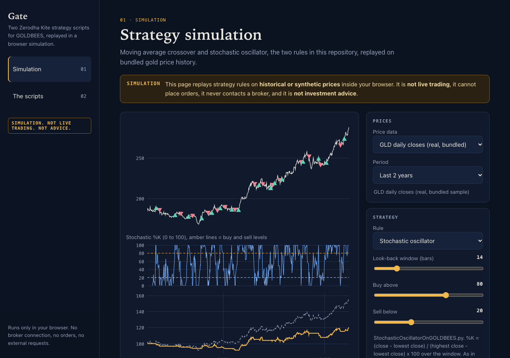

# Gate

Python scripts for trading **GOLDBEES** (a gold ETF on India's NSE) through the Zerodha Kite web API, plus a browser simulation of the two strategies they implement: a moving average crossover and a stochastic oscillator.



> **The scripts have not been run against a broker.** They need a live Zerodha login and can place real orders. Everything below that carries a number comes from the offline simulation or from offline checks, not from live trading. Nothing here is investment advice.

## Try the demo

Open `docs/index.html` in any browser (double-click it; it is one self-contained file with no network requests). GitHub Pages is not enabled, so there is no hosted link.

The page is a **simulation**: it replays the two rules on historical or synthetic daily prices. It cannot place orders and never contacts a broker. You can pick the strategy, its windows and thresholds, real GLD prices or a seeded random walk, one-bar-delayed or same-bar fills, and a cost per trade. It lists every simulated trade.

## Run the scripts

```bash
pip install -r requirements.txt
export KITE_ENCTOKEN=...        # your own Kite session token; never put it in a file
python MovingAverageCrossoverOnGOLDBEES.py
```

- `KITE_ENCTOKEN` is the `enctoken` value from your own logged-in kite.zerodha.com session (see the comments at the top of `ApiCommands.py` for where to find it). The scripts exit with a message if it is not set.
- **Orders are off by default.** The scripts only print `DRY RUN` unless you also `export KITE_PLACE_ORDERS=1`. Leave it unset until you have read the code and understand what it will do.
- The token expires when you log out of Kite.

## Scripts

| Script | What it does | Data it reads | Measured result |
|---|---|---|---|
| `kit_trade.py` | Small unofficial Kite client (`KiteApp`: historical candles, quotes, orders, positions, margins; `get_enctoken()` for a password login). | Zerodha API | Did not parse (syntax error). Now parses; `historical_data` checked offline against a mocked HTTP session: 2 candles parsed correctly, an HTTP 403 returns `None`. |
| `ApiCommands.py` | Cheat sheet of calls: margins, orders, positions, instruments, quotes, historical data, place/modify/cancel an order. | Zerodha API | Not run (needs a session). Exits with the token message when `KITE_ENCTOKEN` is unset. |
| `MovingAverageCrossoverOnGOLDBEES.py` | Every 60 s fetches 7 days of 5-minute candles (instrument 3693569), keeps lists of the 10-bar and 20-bar averages, signals a buy when the short list's average is above the long one's. | Zerodha API | Not run. Simulated on GLD: see below. |
| `StochasticOscillatorOnGOLDBEES.py` | Every 5 minutes computes %K over the closes of the last 7 days; buys 1 GOLDBEES above 80, sells 1 below 20 (intraday MIS product). | Zerodha API | Not run. Simulated on GLD: see below. |

### Simulation results (GLD daily closes, fills one bar after the signal, no costs)

GLD is a US-listed gold ETF, used as a stand-in because GOLDBEES is not in the repository. The 5,123 closes (2004-11-18 to 2025-03-31) are copied from the Gate-2.0 data folder (`GLD_1d.csv`).

| Rule (parameters) | Period | Strategy return | Buy and hold | Closed trades | Max drawdown |
|---|---|---|---|---|---|
| Moving average crossover (10/20) | last 2 years (500 closes from 2023-04-03) | 20.72% | 55.74% | 14, plus 1 open | -9.48% |
| Stochastic oscillator (14, buy above 80, sell below 20) | last 2 years | 20.35% | 55.74% | 15, plus 1 open | -8.32% |
| Moving average crossover (10/20) | full history | 143.93% | 547.61% | 136, plus 1 open | not recorded |
| Stochastic oscillator (14, 80, 20) | full history | 146.98% | 547.61% | 157, plus 1 open | not recorded |

Synthetic random walk (seed 42, 1,500 days, no real pattern to find): crossover 51.62% against 108.89% for holding; stochastic 24.40%.

Neither rule beat simply holding in these runs. That is one price history and a handful of settings, so it says little about either rule, and it should not be read as a recommendation. The simulation page's numbers match an independent pandas/numpy implementation on 8 configurations (return, number of trades, sum of trade returns, time invested).

## How each strategy works

**Moving average crossover.** Compare a short average of recent closes with a long one (10 and 20 bars). When the short one is above the long one the trend is read as up, so buy. The script keeps a running list of each average as it polls every 60 seconds and compares the average of those lists, which makes it a smoothed version of the textbook rule that depends on how long it has been running. The simulation uses the textbook form on daily bars and adds an exit (leave when the short average is at or below the long one), because the script has none.

**Stochastic oscillator.** %K places the latest close inside the recent range: `(close - lowest) / (highest - lowest) x 100`. The script buys above 80 and sells below 20. That is the opposite of the usual reading, where above 80 means overbought and below 20 oversold; the simulation follows the script. The script uses closes only (not highs and lows) over a 7-day window of 5-minute candles; the simulation uses a rolling window of daily closes (default 14).

## Honest notes

- Simulated with daily closes; the scripts use 5-minute candles, so intraday behaviour, slippage, brokerage, taxes and short selling are not modelled.
- Long only, one position, all-in/all-out. The stochastic script's "sell" with no holding would be a short sale on the real exchange; the simulation sells only what it bought.
- Neither script tracks whether it already holds a position, so on a real run they would repeat orders on every pass. This is not changed.
- The live scripts cannot be tested without a broker session. The only checks run were `ast.parse` on every file, the no-token exit message, and the mocked-HTTP test of `historical_data`.
- Real series is GLD, not GOLDBEES. Past results do not predict future ones.

## Fixes made

1. **Security: hard-coded session tokens removed.** `MovingAverageCrossoverOnGOLDBEES.py` and `StochasticOscillatorOnGOLDBEES.py` had Kite `enctoken` values typed into the source. They now read `KITE_ENCTOKEN` from the environment. **The old tokens are still in the Git history** (commits before this change). History was not rewritten. Log out of Kite to invalidate them; they should not be reused.
2. `kit_trade.py`: the body of `historical_data` was not indented, so the file did not parse. Indented; the failure message now reports the HTTP status instead of "No Buy or Sell Signal".
3. Imports: the scripts imported `kite_trade` and `ApiCommands.py` imported `kite_app`; the module is `kit_trade.py`. All three now import `kit_trade`.
4. `MovingAverageCrossoverOnGOLDBEES.py`: the buy order was missing and the code printed an undefined `order`; added a guarded `place_buy_order()`. Empty-list division on startup is guarded.
5. `StochasticOscillatorOnGOLDBEES.py`: the 7-day window is recomputed on each pass (it was computed once); a flat window no longer divides by zero; the loop sleeps after an error instead of retrying instantly.
6. Orders in all three scripts are gated behind `KITE_PLACE_ORDERS=1` (dry run by default). `ApiCommands.py` also placed a real order for ACC when run; that block is now gated.

## Repository layout

```
Gate/
├── README.md
├── requirements.txt
├── .gitignore
├── ApiCommands.py
├── MovingAverageCrossoverOnGOLDBEES.py
├── StochasticOscillatorOnGOLDBEES.py
├── kit_trade.py
└── docs/
    ├── index.html          single-file simulation (no external requests)
    └── assets/             screenshots used in this README
```

## Requirements

Python 3.8 or later; `requests` and `python-dateutil` (see `requirements.txt`). The demo needs only a browser.
